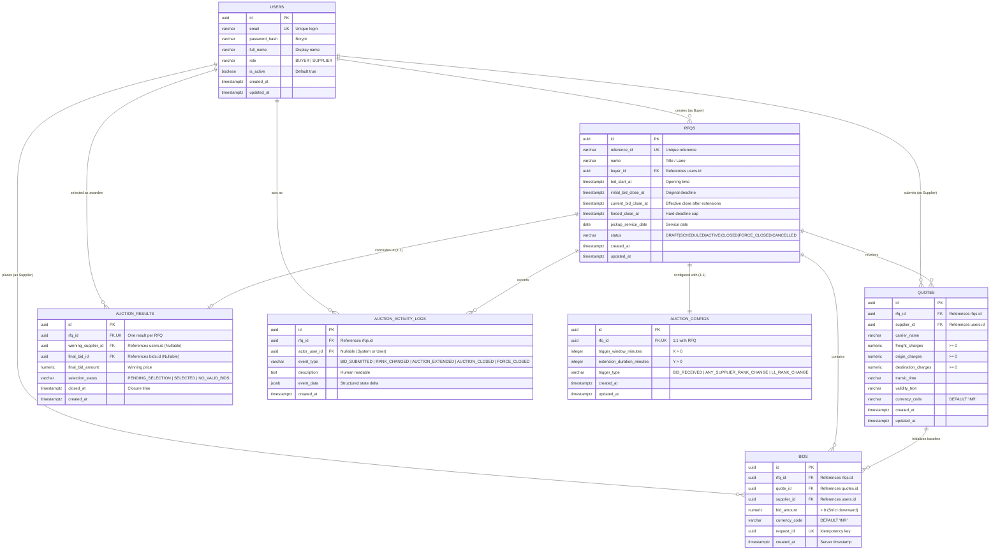

# Entity-Relationship (ER) Diagram

The following Mermaid diagram visualizes the relational structure, primary keys, foreign keys, cardinality, and constraints across the 7 core database tables.

---

## Cardinality & Structural Integrity

1. **One-to-One RFQ Configuration:** Every RFQ has exactly one British Auction configuration row in `auction_configs` defining parameters $X$, $Y$, and the active trigger condition.
2. **One-to-Many Quotes per RFQ:** Multiple competing suppliers submit their initial quotation breakdown to an RFQ.
3. **One-to-Many Bids per Quote:** Each supplier can submit multiple downward bids over the lifetime of the active auction, all linked back to their originating quote breakdown and RFQ.
4. **Append-Only Bid Log:** Bids are never mutated or deleted in place, preserving an immutable audit trail for forensic review and ranking re-calculation.
5. **One-to-Zero/One Final Result:** When an auction reaches closure or forced closure, an `auction_results` record is generated to snapshot the final state and track the buyer's award decision.
