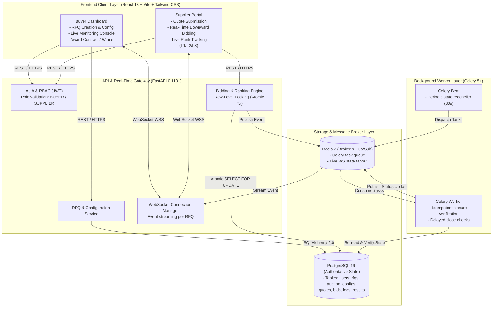

# DELIVERABLE 1: High-Level Design (HLD)

## 1. Executive Summary & Purpose

The **British Auction in RFQ System** is an enterprise-grade procurement web application designed to orchestrate reverse downward auctions with dynamic anti-sniping bid-time extensions and hard forced closure boundaries. 

The application enables **Buyers** to create commercial RFQs and configure British Auction parameters, and allows **Suppliers** to submit commercial charge breakdowns and compete in real-time by reducing their prices to achieve the lowest bid ranking (**L1**).

---

## 2. High-Level Architecture Diagram

---

## 3. Component Responsibilities

| Component | Technology | Primary Responsibilities |
|---|---|---|
| **Frontend SPA** | React 18, Vite, TypeScript, Tailwind CSS | Enterprise-grade UI/UX with live digital countdown timers, interactive downward bidding console, live ranking table, commercial quotation breakdown view, and chronological activity feed. |
| **API Backend** | Python 3.11, FastAPI, Pydantic v2 | High-concurrency async REST API, request payload validation, JWT authentication, role-based authorization, and WebSocket broadcasting. |
| **Bidding Engine** | SQLAlchemy 2.0 (Row Lock) | Executes competitive downward bid submissions under serializable/row-level lock (`SELECT ... FOR UPDATE`), enforces downward bidding rules, calculates differential supplier rankings, evaluates extension triggers, and caps at forced close time. |
| **Supplier Ranking Service** | Python Service | Computes L1 (lowest), L2, L3... rankings using each supplier's latest valid accepted bid, enforcing deterministic tie-breaking (earliest timestamp wins). |
| **Extension Engine** | Python Service | Evaluates the 3 extension triggers (`BID_RECEIVED`, `ANY_SUPPLIER_RANK_CHANGE`, `L1_RANK_CHANGE`) within trigger window $[T_{\text{current\_close}} - X, T_{\text{current\_close}})$. Computes: $\text{New Close} = \min(T_{\text{current\_close}} + Y, T_{\text{forced\_close}})$. |
| **Closure Service** | Python Service | Idempotently transitions auctions to `CLOSED` or `FORCE_CLOSED`, snapshots winning supplier and final bid amount into `auction_results`. |
| **PostgreSQL Database** | PostgreSQL 16 | ACID transactional persistence and authoritative source of truth. |
| **Redis** | Redis 7 | Message broker for Celery asynchronous tasks and WebSocket pub/sub event distribution. |
| **Celery Worker & Beat** | Celery 5.x | Executes background closure checks with database re-read verification to prevent premature closure from stale tasks; periodically reconciles scheduled and active auctions. |

---

## 4. End-to-End Data Flow

### 4.1 RFQ Creation & Publishing
1. Buyer creates RFQ via `POST /api/v1/rfqs` specifying Reference ID, Name, Bid Start, Bid Close, Forced Close, Service Date, and British Auction parameters ($X, Y$, Trigger Type).
2. Backend validates that $\text{Bid Close} > \text{Bid Start}$ and $\text{Forced Close} > \text{Bid Close}$.
3. Status begins as `DRAFT` and transitions to `SCHEDULED` (or `ACTIVE` if start time is current) upon publishing.

### 4.2 Quotation Submission & Baseline Seeding
1. Supplier submits commercial breakdown via `POST /api/v1/rfqs/{id}/quotes` (Carrier Name, Freight, Origin, Destination, Transit Time, Validity).
2. The system registers the quotation and automatically creates the supplier's initial baseline bid in `bids` with $\text{Amount} = \text{Freight} + \text{Origin} + \text{Destination}$.

### 4.3 Competitive Downward Bidding & Dynamic Extension
1. Supplier submits revised price via `POST /api/v1/rfqs/{id}/bids`.
2. Backend locks the RFQ row (`SELECT ... FOR UPDATE`), validates that auction is `ACTIVE`, server time $< \text{Current Close}$, and bid amount is strictly lower than supplier's previous accepted price.
3. Pre-bid rankings are snapshotted. The bid is inserted into `bids`.
4. Post-bid rankings are calculated.
5. If server timestamp falls within the trigger window $[T_{\text{close}} - X, T_{\text{close}})$:
   - Evaluates active trigger condition (`BID_RECEIVED`, `ANY_SUPPLIER_RANK_CHANGE`, or `L1_RANK_CHANGE`).
   - If satisfied: $\text{New Close} = \min(T_{\text{close}} + Y, T_{\text{forced\_close}})$.
6. Bid and extension records are committed atomically.
7. WebSocket broadcasts `NEW_BID` to all connected clients, updating live countdowns and rank tables.

### 4.4 Idempotent Auction Closure & Winner Award
1. When closing time arrives, Celery worker or periodic Beat reconciler executes `check_auction_closure`.
2. Worker re-reads PostgreSQL with a lock:
   - If auction was extended and current time $< \text{Current Close}$, worker exits without closing.
   - If current time $\ge \text{Forced Close}$, marks `FORCE_CLOSED`.
   - If current time $\ge \text{Current Close}$, marks `CLOSED`.
3. Creates snapshot in `auction_results` with `selection_status = PENDING_SELECTION`.
4. Buyer reviews results and confirms award to supplier via `POST /api/v1/rfqs/{id}/select-winner`.

---

## 5. Architectural Decisions & Trade-offs

1. **Relational Database over Graph DB:** The JD lists Neo4j as "good-to-have". However, procurement auctions are strictly relational and require ACID consistency, row-level locking, and exact decimal arithmetic. PostgreSQL was selected as the sole authoritative data store.
2. **FastAPI WebSockets with Redis Pub/Sub:** Enables sub-second live updates without polling.
3. **Server-Generated UTC Timestamps:** Browser timestamps are strictly ignored to prevent client-side time manipulation.
